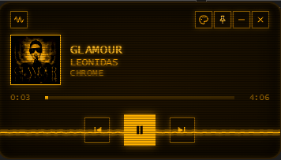

# widdesk

Small, floating desktop widgets that sit on top of your work and stay out of the way. Each widget is a self-contained project with its own dependencies, documentation and tests.



## Widgets

| Widget | Description | Platform |
| --- | --- | --- |
| [Music Visualizer](music-visualizer/) | Visualizes system audio in real time and shows the current track with playback controls, seek and album art. Supports live-switchable skins. | Windows |

## Requirements

- [Node.js](https://nodejs.org/) 22.12 or later (required by Electron).
- npm.
- Platform requirements vary per widget; see each widget's README.

## Getting started

```bash
git clone https://github.com/MatiasArmada/widdesk.git
cd widdesk/<widget-folder>
npm install
npm start
```

## Repository layout

```
widdesk/
├── LICENSE
├── README.md
└── music-visualizer/     one folder per widget
    ├── package.json      its own dependencies and scripts
    ├── README.md         usage and architecture
    ├── src/
    └── test/
```

Widgets do not share code or dependencies. To add a new widget, create a new top-level folder with its own `package.json` and `README.md`, and add a row to the table above.

## License

[MIT](LICENSE) © 2026 Mat Armada
